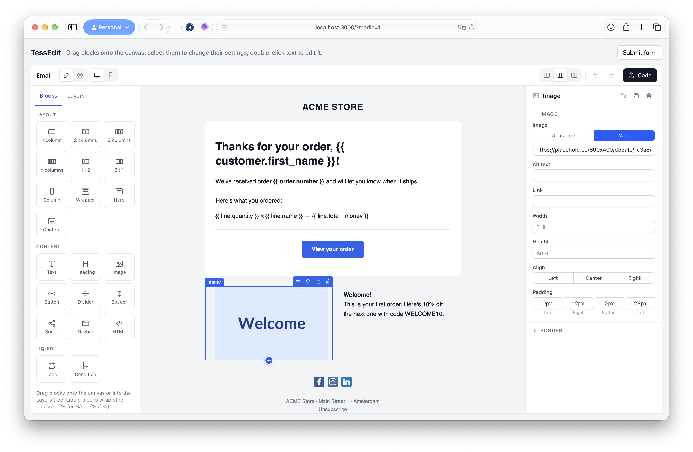
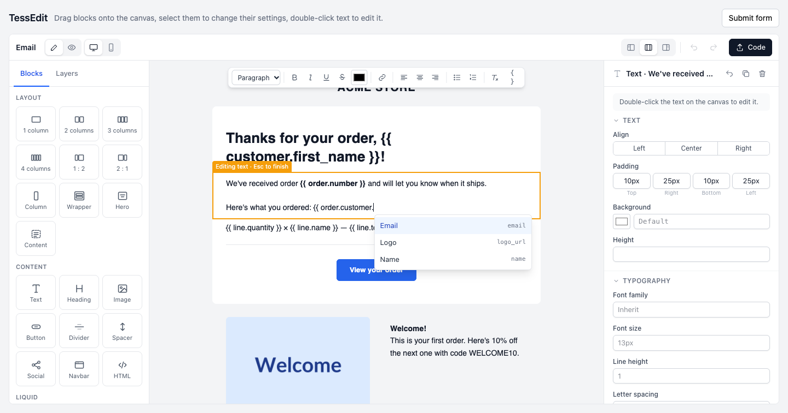

# TessEdit

TessEdit is a drag-and-drop email editor for Rails, written in plain JavaScript with Stimulus. You build an email from blocks; the editor stores the design as JSON and exports [MJML](https://mjml.io) and responsive HTML. Blocks can hold [Liquid](https://shopify.github.io/liquid/), which survives into the HTML so it can be rendered at send time.

What it makes is a kit: the email is built in, and your app can add its own, such as the demo's Note, with blocks of its own and TessEdit's (see [Kits](#kits)).

The interface follows familiar layout: blocks and a layers tree on the left, the email in the middle, and Inspect, with the selected block's settings, on the right.



It completes Liquid tags and variables as you type, making it easier to work with dynamic content.


## Features

- Blocks: Section (1-4 columns), Column, Wrapper, Hero, Text, Heading, Image, Button, Divider, Spacer, Social, Navbar and raw HTML.
- Liquid blocks: **Loop** (``) and **Condition** (``) wrap other blocks.
- Drag from the Blocks panel onto the canvas or into the Layers tree; move blocks on the canvas (drag handle) or in the tree; plus buttons and empty-column placeholders open an "Add block" menu.
- Rich text editing on the canvas with [Tiptap](https://tiptap.dev): bold, italic, underline, strikethrough, colour, links (Liquid allowed in the URL), alignment, lists and headings.
- Your app's Liquid variables suggested while typing `{{`, in text and in settings, and browsable from `{ }` buttons, including those of the Loop blocks around a block.
- Your app's translations for Liquid's `t` filter (`{{ '.greeting' | t }}`) shown as their text in a language of your choice, with every language's text, missing ones marked, editable when pointed at, and selected text made translatable.
- Undo/redo, duplicate, delete, keyboard shortcuts (⌘Z, ⇧⌘Z, ⌘D, Delete, Enter to edit text, Esc).
- Desktop and mobile preview, and a preview of the HTML as sent.
- Panels on both sides, or combined as tabs in one sidebar on the left or right to give the canvas more room.
- Dark mode that follows the host app's.
- Code dialog to view, copy or download the JSON, MJML and HTML, and to load JSON.
- Kits: other kinds of documents, registered by your app, with its own blocks and output and TessEdit's blocks brought in.
- Layouts: a Content block marks where the documents using a layout put their own blocks, and a lock keeps the rest of the layout as it is.
- Palette sources: tiles from your app in the Blocks panel, such as saved snippets, inserted as a copy that remembers where it came from.

## Installation

```ruby
gem "tess_edit", github: "tdegrunt/tess_edit"
```

The engine adds its pins to your import map. Mount it for the compile endpoint (see [Compiling](#compiling)):

```ruby
# config/routes.rb
mount TessEdit::Engine => "/tess_edit"
```

Register the controller with your Stimulus application:

```js
// app/javascript/application.js
import { application } from "controllers/application"
import { registerTessEdit } from "tess_edit"

registerTessEdit(application)
```

### Tailwind CSS 4 required

The editor builds its interface with Tailwind classes, so it needs Tailwind CSS 4 through [`tailwindcss-rails`](https://github.com/rails/tailwindcss-rails) 4.3 or later. Tailwind 3 is not supported.

```ruby
gem "tailwindcss-rails", ">= 4.3"
```

Import the editor's styles after Tailwind itself:

```css
/* app/assets/tailwind/application.css */
@import "tailwindcss";
@import "../builds/tailwind/tess_edit";
```

`app/assets/builds/tailwind/tess_edit.css` is generated by `bin/rails tailwindcss:build` (and `tailwindcss:watch`, `bin/dev`) from the gem's `app/assets/tailwind/tess_edit/engine.css`. It points to wherever the gem is installed, so the line above is the same on every machine. Leave `app/assets/builds` out of version control, as Rails apps do by default. If the import fails because the file is missing, run `bin/rails tailwindcss:engines` or a build once.

### Dark mode

The editor's panels, menus and dialogs have `dark:` variants, so they follow your app's dark mode: by default the OS setting (`prefers-color-scheme`), or whatever your app makes `dark:` mean with `@custom-variant dark`, such as a `.dark` class on `<html>`. The email on the canvas keeps its own colours, as it is sent.

## Usage

Give the controller an element with a height and, optionally, hidden inputs to keep up to date:

```erb
<div data-controller="tess-edit" style="height: 80vh">
  <%= form.hidden_field :json, data: { tess_edit_target: "jsonInput" } %>
  <%= form.hidden_field :mjml, data: { tess_edit_target: "mjmlInput" } %>
  <%= form.hidden_field :html, data: { tess_edit_target: "htmlInput" } %>
</div>
```

The editor loads the document from the `jsonInput` (or from `data-tess-edit-document-value`). With neither, it starts with a sample email; set `data-tess-edit-sample-value="false"` to start with an empty email.

`data-tess-edit-panels-value` sets the default panel layout: `split` (Blocks and Layers on the left, Inspect on the right, the default), `left` or `right` (Blocks, Layers and Inspect as tabs in one sidebar on that side). People can switch with the buttons in the top bar; their choice is remembered in the browser. When the editor is narrower than 1000px, it puts all panels on the left so the canvas keeps its room, and goes back to the chosen layout when it is wide enough again.

Every change updates the inputs and dispatches `tess-edit:change` with `{ json, mjml, html, errors, document }` in `event.detail`. When the MJML can't be compiled, `html` is empty and `errors` says why; the editor shows the reason under the canvas. The controller instance is available as `element.tessEdit`, with `getDocument()`, `setDocument(json)` and `export()`.

### What gets stored

| Field | Contents |
|---|---|
| `json` | The block tree. The source of truth; load it back into the editor. |
| `mjml` | MJML generated from the JSON. Loops and conditions are `<mj-raw></mj-raw>`. |
| `html` | The MJML compiled to HTML on the server, with Liquid left in place. |

Render the HTML with Liquid when sending. A host app can also store only the JSON or MJML and compile on its own with `TessEdit.compile(mjml)`.

### Compiling

The editor turns the JSON into MJML in the browser and has the server compile the MJML to HTML, with [MRML](https://github.com/jdrouet/mrml) (the `mrml` gem, precompiled, no Node or Rust needed). The canvas, the preview and the `html` input all come from the same compiler the host app uses when it sends:

```ruby
result = TessEdit.compile(mjml)
result.html   # nil when the MJML can't be parsed
result.errors # [] or the reasons
```

The editor posts to `/tess_edit/compile`, debounced, with the page's CSRF token (`csrf_meta_tags`). Mounted elsewhere, give the editor the path with `data-tess-edit-compile-url-value`. The endpoint's controller inherits from `ActionController::Base`; make it inherit from one of your controllers so it sits behind the same sign-in and authorization:

```ruby
# config/initializers/tess_edit.rb
TessEdit.parent_controller = "Admin::BaseController"
``` Liquid inside HTML attributes, such as a button link of `{{ order.url }}`, has its double quotes changed to single quotes, which Liquid treats the same.

### The document format

```json
{
  "version": 1, "id": "b1x2y3z", "type": "root",
  "attributes": { "width": "600px", "background-color": "#f3f4f6" },
  "data": { "subject": "...", "preheader": "...", "fontFamily": "..." },
  "children": [
    { "id": "...", "type": "section", "attributes": { "padding": "20px 0px" }, "data": {}, "children": [
      { "id": "...", "type": "column", "attributes": {}, "data": {}, "children": [
        { "id": "...", "type": "text", "attributes": { "align": "center" }, "data": { "content": { "type": "doc", "content": [] } }, "children": [] }
      ] }
    ] }
  ]
}
```

The top node is the `root` block, which renders the `<mjml>` document with the subject, preview text and theme. Documents from before its rename, with `"type": "page"`, still load. `attributes` map onto MJML attributes; `data` holds everything else. Text content is Tiptap (ProseMirror) JSON, so other renderers, such as a kit's own, can walk it.

### Locking a layout

To let people fill in one part of a design that is otherwise fixed, such as a template's own content inside a shared layout, give the editor a lock:

```erb
<div data-controller="tess-edit"
  data-tess-edit-lock-value='<%= {except: ["content"], fields: ["data.subject", "data.preheader"]}.to_json %>'>
```

Only what is inside blocks of the types in `except` can change: those blocks take new blocks, and everything in them can be edited, moved, duplicated and deleted. The blocks themselves stay where they are. Of the root, only the listed `fields` can change. Everything else still shows on the canvas and can be selected, with its settings disabled in Inspect and a lock in Layers. A tile clicked while a locked block is selected goes at the end of the first block it is allowed in, and the Code dialog shows the JSON without loading it. The editor still stores the whole document; taking the open part out of it is up to the host app. The `except` type is usually `content`, the Content block (see Layouts).

### Layouts

The Content block (in the Layout category of the Blocks panel) marks where the documents using a layout put their own blocks; a layout has one. What a layout has inside it is example content to design the layout with. Outside the editor its contents are between two comments, in `<mj-raw>` tags in MJML:

```html
<!-- tess-edit:content --> … <!-- /tess-edit:content -->
```

A document using a layout stores its own blocks. `TessEdit::Content` puts them in and takes them out again, and puts a document's output into its layout's, so a document follows its layout when the layout changes:

```ruby
document = TessEdit::Content.document_with(layout.json, template.blocks)  # for the editor, locked to the Content block
blocks = TessEdit::Content.nodes(JSON.parse(params[:json]))               # what to store when it is saved
html = TessEdit::Content.merge(layout.html, TessEdit::Content.content_of(params[:html]))
```

### Palette sources

A palette source adds a section of tiles from your app to the Blocks panel, such as saved snippets. People drag a tile onto the canvas or click it, and the source creates the node that goes in:

```js
import { registerPaletteSource, renumber } from "tess_edit"

registerPaletteSource({
  key: "snippets",
  label: "Snippets",
  // null leaves the section out, e.g. without the setting it needs
  items: async (editor) => {
    if (!editor.options.snippetsUrl) return null
    const response = await fetch(editor.options.snippetsUrl)
    return (await response.json()).snippets // [{ key, label, type, … }]
  },
  // The node to insert, here a copy of the snippet's block
  create: async (item, editor) => renumber(item.block, { origin: true })
})
```

An item's `type` says where the tile can go; a container with `accepts: "inherit"` goes where its children go, so a snippet with sections can't go into a column, and the editor says so. `renumber(node, { origin: true })` gives every copied block an `origin`, the id of the block it is a copy of, so your app can compare the copy with what it came from, block by block. A duplicated block is new content and has no origin. `data-tess-edit-options-value` passes settings such as `snippetsUrl` to sources and blocks, as `editor.options`.

`data-tess-edit-blocks-value` limits the blocks people can add, e.g. `["text", "image"]`; blocks already in the document, and tiles from sources, aren't affected.

### Images

By default images are URLs. To let people choose from your app's images and upload new ones, give the editor an endpoint with `data-tess-edit-media-url-value`. Every image then has a source, Uploaded (a dropdown of your images with an Upload button) or Web (a URL): the Image block's image and the background images of heroes, sections and wrappers. New Image blocks start as Uploaded. An image file dragged from the desktop onto the canvas is uploaded and put in the nearest block with an image, an Image block or else the background of the hero, section or wrapper it's dropped on, and shows straight away while it uploads.

The endpoint answers two requests, both as JSON:

- `GET`: the images to choose from, `{"images": [{"id": "…", "url": "https://…", "name": "logo.png"}]}`
- `POST` (multipart, the file in `file`, with the page's CSRF token): the uploaded image, `{"id": "…", "url": "…", "name": "…"}`, or `{"errors": ["…"]}` with an error status

A block stores the image's `url` in the attribute (`src`, `background-url`) and its `id` next to it in `data`: `data.image` for the Image block, `data.background` for backgrounds. How images are stored and who may upload them is up to your app; the dummy app's `MediaController` is a minimal example (`/?media=1`).

A block of your own gets the same with an image field, `imageField("attributes.background-url", "Background image", "data.background")`, imported from `tess_edit`.

### Variables

To suggest the variables a template can use, give the editor an endpoint with `data-tess-edit-variables-url-value`. Typing `{{` in text on the canvas, or in a setting such as a link, subject or image address, then shows them, one level at a time: `order.` shows the order's variables, `order.customer.` the customer's. Arrow keys and Enter or Tab choose, Escape closes. The text toolbar, and settings that usually hold Liquid, have a `{ }` button to browse them instead. A Loop's collection and a Condition are suggested without the braces.

The endpoint answers `GET` with the variables at `path` (the roots without one), as JSON:

```json
{"path": "order", "variables": [
  {"name": "customer", "label": "Ordered by", "type": "object", "collection": false, "children": true},
  {"name": "order_lines", "label": "Order lines", "type": "object", "collection": true, "children": true},
  {"name": "total", "label": "Total", "type": "money", "hint": "Including VAT", "collection": false, "children": false}
]}
```

`children` says a variable has variables of its own, at the path with its name added; a `collection` is a list of them, and its path goes into its elements (`order.order_lines.product`). The editor offers a collection's `first`, `last` and `size`, and inside a Loop block (``) its variable, `line`, asking for `order.order_lines.…` for it. An unknown path answers 404. [Liquidum](https://github.com/entdec/liquidum)'s `/liquidum/variables` answers this way from your drops; the dummy app's `VariablesController` is a fixed example (`/?variables=1`).

A field of your own gets the `{ }` button with `liquid: true`, or `liquid: "expression"` (a condition) or `liquid: "collection"` (what a loop goes over) for Liquid without braces.

### Translations

To show and edit translations for Liquid's `t` filter, as [Liquidum](https://github.com/entdec/liquidum) has it (`{{ '.greeting' | t }}`, `{{ "order.shipped" | t: name: order.name }}`), give the editor an endpoint with `data-tess-edit-translations-url-value`. Then:

- The top bar has a language menu. The canvas shows each `t` filter on a quoted key as its text in that language, or the Liquid when it has none (marked red when a language is missing it). "Keys" shows the Liquid everywhere. A filter that names a locale (`t: locale: 'nl'`) shows that one.
- Pointing at one lists its text in every language. Each can be edited there, and the arrow opens where your app keeps it.
- In text being edited on the canvas a filter shows as its text until the caret goes into it; a click on it does that.
- The text toolbar, and settings that usually hold Liquid text, have a "Make translatable" button: it asks for a key (suggested from the text), saves the selected text (or the whole setting) as that key's text in the chosen language, and puts `{{ '<key>' | t }}` in its place. Variables in the text become placeholders, given as the filter's arguments: "Hi {{ user.first_name }}" is saved as `Hi %{first_name}`, with `{{ '<key>' | t: first_name: user.first_name }}`; Liquid tags and filters can't go into a translation. Below such a setting its filters show their text.
- Placeholders (`%{name}`) show apart in a text; one the filter has no argument for is marked.
- Typing `{{ '` suggests the keys, with their text.

The endpoint answers, as JSON:

- `GET` with the keys in the document, comma-separated in `keys`: the languages, the translations of those keys and of the keys to suggest, and the keys to suggest
  ```json
  {"locales": ["en", "nl"],
   "translations": {".greeting": {"en": {"value": "Hello", "source": "Account › en", "url": "/locales/1/edit"}, "nl": null}},
   "suggestions": [".greeting"]}
  ```
  A missing text is `null`; `source` says where a text comes from (shown when pointed at) and `url` where to edit it (both optional).
- `PATCH` with `{"key": "…", "locale": "nl", "value": "…"}` (JSON, with the page's CSRF token): `{"key": "…", "translation": {"en": …, "nl": …}}`, or `{"errors": ["…"]}` with an error status

Where the texts are kept, and what a key starting with a dot is relative to, is up to your app. The dummy app's `TranslationsController` keeps them in memory (`/?translations=1`).

### Blocks and custom blocks

Every block is a plugin: one module in `app/javascript/tess_edit/blocks/` with its defaults, its Inspect fields, its Blocks panel tiles and a `render.mjml` hook. The built-in blocks are registered the same way a host app registers its own, so register yours before the editor connects:

```js
import { application } from "controllers/application"
import { fields, registerBlock, registerCategory, registerTessEdit } from "tess_edit"

registerCategory({ key: "shop", label: "Shop", order: 40 })

registerBlock({
  type: "product",                       // stored in the document JSON
  name: "Product",
  icon: "image",                         // a built-in icon name, or SVG markup (24×24 viewBox)
  category: "shop",                      // gives it one tile; use `palette: [...]` for more, or none
  roles: ["content"],                    // goes where content goes: columns, heroes, Liquid blocks in them
  defaults: () => ({ attributes: { padding: "10px 25px" }, data: { sku: "" } }),
  fields: [{ title: "Product", fields: [{ key: "data.sku", label: "SKU", type: "text" }, fields.padding] }],
  label: (node) => `Product · ${node.data.sku}`,
  render: {
    mjml: (node, { element, escapeText }) =>
      element("mj-text", node, `{{ products['${escapeText(node.data.sku)}'].title }}`)
  }
})

registerTessEdit(application)
```

Roles say where a block may go: `body` (in the root or a wrapper, like sections and heroes), `wrapper`, `column` (in a section) and `content` (in a column or hero). A container lists the roles it takes in `accepts`; Loop and Condition use `"inherit"`. The full definition, and the helpers a render hook gets (`element`, `container`, `children`, `liquid`, `attrs`, `richText`, ...), are described at the top of `core/registry.js` and `export/mjml.js`. Blocks render only through their `render` hooks: `mjml` for emails, and a hook of its own for each kit. Stored documents don't change; a document with a block type that isn't registered fails `normalize`.

A select field's `options` can be a function of the editor, `options: (editor) => [...]`, for choices from your app. Give the editor those with `data-tess-edit-options-value` (JSON), which blocks read as `editor.options`.

## Kits

What the editor makes is a kit: a root block, the blocks that name the kit in their `kits`, and what the canvas shows and the editor outputs. The email is the built-in kit and its reference. Your app registers its own with `registerKit` before its root block, and picks it with `data-tess-edit-kit-value`:

```js
import { createDocument, extendBlock, registerBlock, registerKit } from "tess_edit"

registerKit({
  key: "note", name: "Note", root: "note",
  starter: () => createDocument("note"),
  canvas: async (doc, { editor }) => ({ html: toNoteHtml(doc, { editor }), errors: [] }),  // with tess-<id> classes in the editor
  outputs: async (doc) => ({ outputs: { html: toNoteHtml(doc) }, errors: [] })            // into the htmlInput
})
registerBlock({ type: "note", name: "Note", kits: ["note"], accepts: ["body", "content"], render: { note: … } })

// TessEdit's own blocks, in the kit, with how they render in it
extendBlock("text", { kits: ["note"], render: { note: (node, ctx) => … } })
```

A block is part of the email kit unless it says otherwise. `extendBlock` adds kits, render hooks and field groups to a block that is registered, also when another gem replaced it, so the kit can use TessEdit's Text, Image, Section, Loop, Condition, Content and others. The kit renders its documents itself, through its blocks' hooks; the canvas needs every block's element to have the class `tess-<id>`, and an empty container a placeholder with `tessph-<id>`. `core/registry.js` describes the definition. `kits/email.js` is the reference, and the demo's Note kit (`test/dummy/app/javascript/kits/note.js`) a small one of a host app's own.

Loading a document into the editor of another kit fails with a message saying which editor it is for.

## Development

The dummy app in `test/dummy` serves a demo page:

```bash
cd test/dummy && bin/dev
```

`/?lock=1` opens a locked layout (`test/dummy/config/demo_layout.json`) with only its Content block, subject and preview text open.

`/?media=1` gives the editor the demo's image endpoint (`MediaController`), so images can be chosen from a list, uploaded, or dragged onto the canvas from the desktop; uploads go to `test/dummy/tmp/media`. Without it, images are URLs only.

`/?variables=1` gives the editor the demo's variables (`VariablesController`), an order's, to try the suggestions.

`/?kit=note` designs a note: the demo's own kit (`app/javascript/kits/note.js`).

`/?snippets=1` adds the demo's snippets source (`app/javascript/snippets.js`, `SnippetsController`): a greeting and a footer section.

`/?blocks=text,image` only offers those blocks.

`/?translations=1` gives the editor the demo's translations (`TranslationsController`, in memory, in English, Dutch and German). The options combine, e.g. `/?lock=1&media=1&variables=1&translations=1`.

Tests:

```bash
npm test               # JavaScript: document model, kits, export and MJML snapshots (Node 22+)
bin/rails test         # Rails: engine, compile endpoint, MRML and Liquid rendering of the snapshots
bin/rails test:system  # The editor in Chrome, through Selenium
```

`npm test` compares the MJML of every email block, and of the sample email, with the files in `test/javascript/snapshots`. The Rails tests compile those files with MRML and render the sample with Liquid. After an intended change in output, regenerate them and review the diff:

```bash
UPDATE_SNAPSHOTS=1 npm test
```

System tests use a local headless Chrome. With `SELENIUM_URL` set, such as `http://selenium:4444/` in a devcontainer, they use that Selenium server instead and serve the app on this machine's address (or `CAPYBARA_APP_HOST`). `HEADLESS=0` shows the browser.

Tiptap is vendored as a single ES module bundle in `vendor/javascript/tess_edit`. To update it:

```bash
cd script/vendor && npm install && node build.mjs
```

## Backlog

Ideas for later, not planned yet:

- **Importing MJML.** Turn an existing MJML template into a TessEdit document, so designs made elsewhere can be edited here. Parts without a matching block could become HTML blocks.
- **Images whose address is Liquid.** An image with a `src` like `{{ product.image_url }}` shows as a broken image on the canvas. It should show a placeholder there instead, and in Inspect say that the address is filled in when the email is sent.
- **A translation block.** Text that differs per language in one design, e.g. a block with a version of its text per locale, so a host app doesn't need a design per language. (Translations through the `t` filter are there, see Translations.)
- **Translating with a service.** Fill in a key's missing languages with DeepL or an LLM, from the translations popover.
- **Text extensions from the host app.** Tiptap (the vendored bundle exports `Node`, `Mark` and `Extension`) can be extended, but the editor's extensions, the email HTML of rich text (`export/richtext.js`) and the text toolbar are fixed. A call like `registerTextExtension({ extension, toHtml(node, children), button })` would add all three, as `registerBlock` does for blocks. A Liquid variable shown as a chip (`{{ customer.first_name }}`) would be a first example; a translation could be one too. The bundle exports ProseMirror's `Plugin`, `PluginKey`, `Decoration` and `DecorationSet` (used for translations); node views would need more.
- **Dropping an image file where there's no image.** A file dropped on an empty spot in the canvas could add a new Image block there with the upload, instead of being refused.

## License

MIT. The vendored Tiptap is MIT licensed too; MRML, through the `mrml` gem, is MIT licensed.
