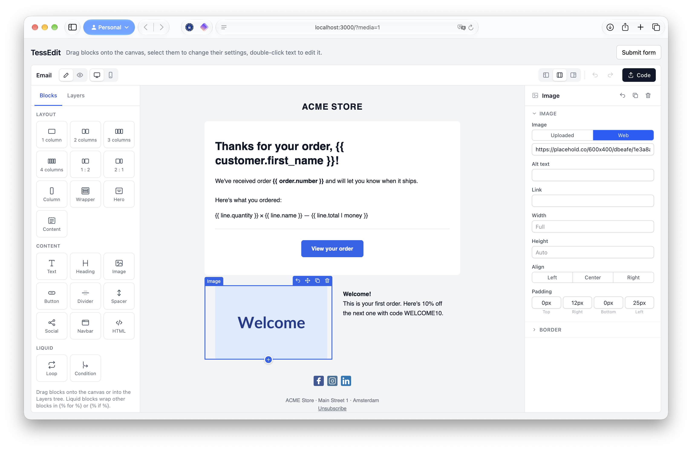
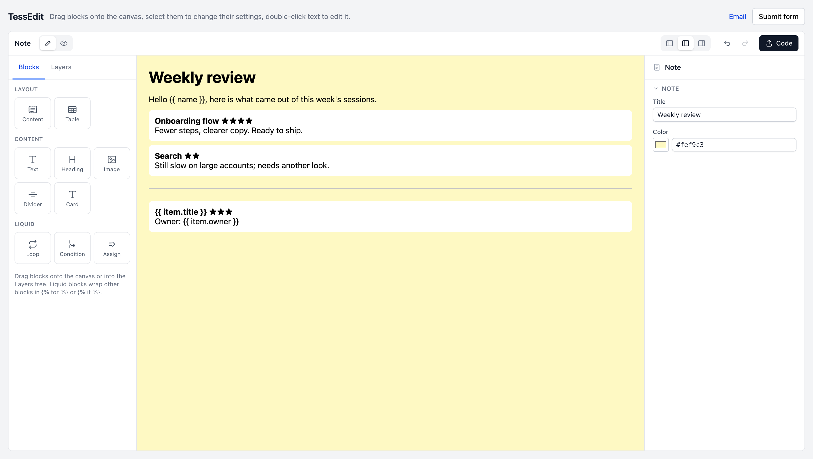
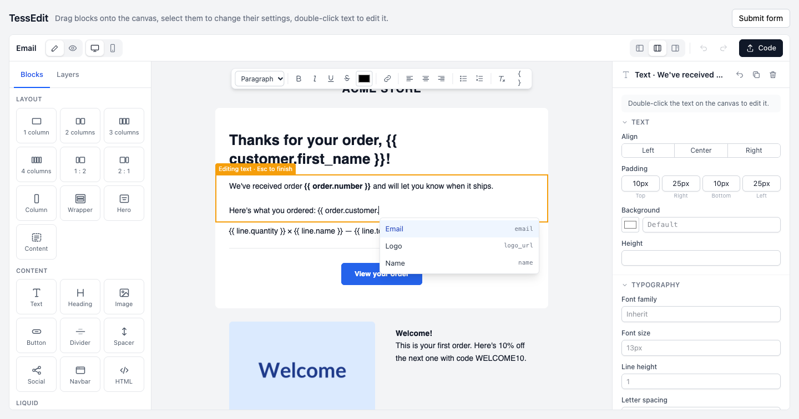

# TessEdit

TessEdit is a drag-and-drop (WYSIWYG) editor for Rails, written in plain JavaScript with Stimulus. You build a document from blocks on a canvas that shows it as it will look; the editor stores it as JSON and turns it into whatever the document is for.

What kind of document that is depends on the kit. A kit is a root block, the blocks that can go in it, and how the canvas shows it and the editor outputs it. TessEdit has none of its own: your app (or a gem) registers them, such as an email, a note, a form, a contract or a text message. A kit has blocks of its own and brings in TessEdit's (Section, Column, Text, Image, Button, Table, Loop, Condition and the rest) with how they render in it. Blocks, kits, Inspect fields, field types, palette sources and server-side compilers are all registered the same way, so everything the editor offers can be extended or replaced (see [Kits](#kits) and [Blocks and custom blocks](#blocks-and-custom-blocks)).

Blocks can hold [Liquid](https://shopify.github.io/liquid/), which survives into the output so it can be rendered later, such as when an email is sent. The editor completes your app's variables, filters and tags as you type, and says what's wrong with the Liquid.

The interface follows a familiar layout: blocks and a layers tree on the left, the document in the middle, and Inspect, with the selected block's settings, on the right. An email, made with [Nuntius](https://github.com/entdec/nuntius)' email kit, which exports [MJML](https://mjml.io) and responsive HTML:



And a note, the demo app's kit, with a Card block of its own and TessEdit's Text, Divider and Loop:



Liquid is completed as you type, in text and in settings:



## Features

- Blocks: Section (1-4 columns), Column, Text, Heading, Image, Button, Divider, Spacer and raw HTML, for a kit to take in, besides its own.
- Liquid blocks: **Loop** (``) and **Condition** (``) wrap other blocks, and **Assign** sets a variable.
- **Tables**: Table, Row and Cell blocks, a cell holding any blocks, with Loops and Conditions (and Assigns) between the rows. On the canvas a cell's menu adds and deletes rows and columns and puts its row in a Loop or Condition, a column's border is dragged to set its width, Tab goes from cell to cell (adding a row after the last), and a bracket by a Loop's or Condition's rows shows what they are.
- Drag from the Blocks panel onto the canvas or into the Layers tree; move blocks on the canvas (drag handle) or in the tree; plus buttons and empty-container placeholders open an "Add block" menu.
- Rich text editing on the canvas with [Tiptap](https://tiptap.dev): bold, italic, underline, strikethrough, colour, links (Liquid allowed in the URL), alignment, lists and headings. A block can have several texts edited on the canvas, rich or a plain line, such as a question's label and its description.
- Your app's Liquid variables suggested while typing `{{`, in text and in settings, and browsable from `{ }` buttons, including those of the Loop blocks around a block and the Assigns before it; after a `|` your app's filters, with a where's property and the values it can have, after `==` the values of what's compared, after `{%` the tags, a block with its end tag, and in conditions the operators; and what's wrong with it, underlined.
- Your app's translations for Liquid's `t` filter (`{{ '.greeting' | t }}`) shown as their text in a language of your choice, with every language's text, missing ones marked, editable when pointed at, and selected text made translatable.
- Your app's values for the Liquid in a document (`{{ customer.first_name }}` as "Ada"), shown in its place until the caret goes into it.
- Clicking a tile in the Blocks panel adds the block in or after the selection, or else at the end of the last block it fits in.
- Undo/redo, duplicate, delete, keyboard shortcuts (⌘Z, ⇧⌘Z, ⌘D, Delete, Enter to edit text, Tab to the next table cell, Esc).
- A preview of the output, and the canvas at the widths a kit gives, such as an email's desktop and mobile.
- Panels on both sides, or combined as tabs in one sidebar on the left or right to give the canvas more room.
- Dark mode that follows the host app's.
- Code dialog to view, copy or download the JSON and the kit's outputs, and to load JSON.
- Kits: any kind of document, registered by your app or a gem, with its own blocks and output and TessEdit's blocks brought in.
- Compilers: a kit whose output is made on the server, such as an email's MJML compiled to HTML, compiles through the engine's endpoint with a compiler your app registers.
- Layouts: a Content block marks where the documents using a layout put their own blocks, and a lock keeps the rest of the layout as it is.
- Palette sources: tiles from your app in the Blocks panel, such as saved snippets, inserted as a copy that remembers where it came from.

## Installation

```ruby
gem "tess_edit", github: "tdegrunt/tess_edit"
```

The engine adds its pins to your import map. For a kit that compiles on the server, mount it for the compile endpoint (see [Compiling](#compiling)):

```ruby
# config/routes.rb
mount TessEdit::Engine => "/tess_edit"
```

Register the controller with your Stimulus application, after the kits your editors make (see [Kits](#kits)):

```js
// app/javascript/application.js
import { application } from "controllers/application"
import { registerTessEdit } from "tess_edit"
import "kits/note"

registerTessEdit(application)
```

A gem can bring kits too: [Nuntius](https://github.com/entdec/nuntius) has an email kit, with MJML, for its templates and campaigns.

### Tailwind CSS 4 required

The editor builds its interface with Tailwind classes, so it needs Tailwind CSS 4 through [`tailwindcss-rails`](https://github.com/rails/tailwindcss-rails) 4.3 or later. Tailwind 3 is not supported.

```ruby
gem "tailwindcss-rails", ">= 4.3"
```

Import the editor's styles after Tailwind itself:

```css
/* app/assets/tailwind/application.css */
@import "tailwindcss";
@import "../builds/tailwind/tess_edit";
```

`app/assets/builds/tailwind/tess_edit.css` is generated by `bin/rails tailwindcss:build` (and `tailwindcss:watch`, `bin/dev`) from the gem's `app/assets/tailwind/tess_edit/engine.css`. It points to wherever the gem is installed, so the line above is the same on every machine. Leave `app/assets/builds` out of version control, as Rails apps do by default. If the import fails because the file is missing, run `bin/rails tailwindcss:engines` or a build once.

### Dark mode

The editor's panels, menus and dialogs have `dark:` variants, so they follow your app's dark mode: by default the OS setting (`prefers-color-scheme`), or whatever your app makes `dark:` mean with `@custom-variant dark`, such as a `.dark` class on `<html>`. The document on the canvas keeps its own colours, as the kit renders it.

## Usage

Give the controller an element with a height, the kit it makes and, optionally, hidden inputs to keep up to date:

```erb
<div data-controller="tess-edit" data-tess-edit-kit-value="note" style="height: 80vh">
  <%= form.hidden_field :json, data: { tess_edit_target: "jsonInput" } %>
  <%= form.hidden_field :html, data: { tess_edit_target: "htmlInput" } %>
</div>
```

`data-tess-edit-kit-value` names a kit your app registered (see [Kits](#kits)); with only one registered, it can be left out. There is an input for the JSON and one for each of the kit's outputs, named after it: an email's `mjml` goes in an `mjmlInput`.

The editor loads the document from the `jsonInput` (or from `data-tess-edit-document-value`). With neither, it starts with the kit's sample, if it has one; set `data-tess-edit-sample-value="false"` to start with an empty document.

`data-tess-edit-panels-value` sets the default panel layout: `split` (Blocks and Layers on the left, Inspect on the right, the default), `left` or `right` (Blocks, Layers and Inspect as tabs in one sidebar on that side). People can switch with the buttons in the top bar; their choice is remembered in the browser. When the editor is narrower than 1000px, it puts all panels on the left so the canvas keeps its room, and goes back to the chosen layout when it is wide enough again.

The editor has a border with rounded corners. A page that frames it itself, such as a card it fills, turns it off with `data-tess-edit-frame-value="false"`.

Every change updates the inputs and dispatches `tess-edit:change` with `{ json, …the kit's outputs, errors, document }` in `event.detail`, e.g. `{ json, html, errors, document }`. When an output can't be made, such as MJML that can't be compiled, `errors` says why; the editor shows the reason under the canvas. The controller instance is available as `element.tessEdit`, with `getDocument()`, `setDocument(json)` and `export()`.

### The editor's language

The editor's own words (its labels, hints and messages) are in English, and in Dutch in `config/locales/nl.yml`. To show them in the page's language (`I18n.locale`), put `tess_edit_translations` in the editor:

```erb
<div data-controller="tess-edit" style="height: 80vh">
  <%= tess_edit_translations %>
  …
</div>
```

It renders a `<script type="application/json">` with each English text and what it says in that language (`tess_edit.editor` in your locale files, where your app can change or add a language). Blocks, kits and fields of your own are written in English too, and the editor translates their names, group titles, labels, hints, placeholders and options where it shows them: give their texts keys in a scope of your own, the English as in your JavaScript, and name it:

```yaml
# config/locales/nl.yml (and the English in en.yml)
nl:
  shop:
    editor:
      product: "Product"
      sku: "Artikelnummer"
```

```erb
<%= tess_edit_translations "shop.editor" %>
```

A text your JavaScript makes itself, such as a block's `label(node)`, uses `t` from `tess_edit/core/i18n` (`t("Product")`, `t("%{count} items", { count })`). A text without a translation shows its English. The dummy app shows the editor in Dutch at `/?locale=nl`.

### What gets stored

| Field | Contents |
|---|---|
| `json` | The block tree. The source of truth; load it back into the editor. |
| the kit's outputs | What the kit makes of it, such as `html`, or an email's `mjml` and `html`, with Liquid left in place. |

Render the Liquid when the document is used, such as when an email is sent. A host app can also store only the JSON and make the output itself, with the same code as the kit.

The fields are written a moment after each change. A form submitted before that, such as a Save clicked right after typing, waits for them and then goes on, also with Turbo.

### Compiling

A kit whose output the browser can't make itself, such as an email's MJML that becomes HTML, has it compiled on the server, by a compiler your app (or the gem with the kit) registers by name:

```ruby
# config/initializers/tess_edit.rb
TessEdit.register_compiler(:mjml) { |mjml| MRML::Template.new(mjml).to_html }
```

The block takes the source and returns the HTML, or a `TessEdit::Result` with the reasons it couldn't; an error it raises is one of those reasons too. Your app compiles with it as the editor does, so the canvas shows what it sends:

```ruby
result = TessEdit.compile(:mjml, mjml)
result.html   # nil when it couldn't be compiled
result.errors # [] or the reasons
```

The kit compiles with `compile` from `tess_edit`, which posts to the engine's endpoint, `/tess_edit/compile`, with `{ compiler, source }` and the page's CSRF token (`csrf_meta_tags`):

```js
import { compile } from "tess_edit"

canvas: (doc, { editor, compileUrl, signal }) => compile(toMjml(doc, { editor }), { compiler: "mjml", url: compileUrl, signal })
```

Mounted elsewhere, give the editor the path with `data-tess-edit-compile-url-value`; a kit gets it as `compileUrl`. The endpoint's controller inherits from `ActionController::Base`; make it inherit from one of your controllers so it sits behind the same sign-in and authorization:

```ruby
# config/initializers/tess_edit.rb
TessEdit.parent_controller = "Admin::BaseController"
```

Line endings are LF by the time a compiler gets the source, also when a browser submitted it with CRLF.

### The document format

```json
{
  "version": 1, "id": "b1x2y3z", "type": "note",
  "attributes": {},
  "data": { "title": "Weekly review", "color": "#fef9c3" },
  "children": [
    { "id": "...", "type": "text", "attributes": { "align": "center" }, "data": { "content": { "type": "doc", "content": [] } }, "children": [] },
    { "id": "...", "type": "loop", "attributes": {}, "data": { "variable": "item", "collection": "actions" }, "children": [] }
  ]
}
```

The top node is the kit's root block, here a note's, which renders the whole document. `attributes` hold a block's styling, named after CSS properties and MJML's attributes, which each kit maps onto its own output; `data` holds everything else. Text content is Tiptap (ProseMirror) JSON, which a kit renders with `richTextToHtml` or walks itself.

### Locking a layout

To let people fill in one part of a design that is otherwise fixed, such as a template's own content inside a shared layout, give the editor a lock:

```erb
<div data-controller="tess-edit"
  data-tess-edit-lock-value='<%= {except: ["content"], fields: ["data.title"]}.to_json %>'>
```

Only what is inside blocks of the types in `except` can change: those blocks take new blocks, and everything in them can be edited, moved, duplicated and deleted. The blocks themselves stay where they are. Of the root, only the listed `fields` can change. Everything else still shows on the canvas and can be selected, with its settings disabled in Inspect and a lock in Layers. A tile clicked while a locked block is selected goes at the end of the first block it is allowed in, and the Code dialog shows the JSON without loading it. The editor still stores the whole document; taking the open part out of it is up to the host app. The `except` type is usually `content`, the Content block (see Layouts).

### Layouts

The Content block (in the Layout category of the Blocks panel) marks where the documents using a layout put their own blocks; a layout has one. What a layout has inside it is example content to design the layout with. Outside the editor its contents are between two comments, which its kit renders, in a tag of their own if the output needs one (an email's are in `<mj-raw>` tags):

```html
<!-- tess-edit:content --> … <!-- /tess-edit:content -->
```

A document using a layout stores its own blocks. `TessEdit::Content` puts them in and takes them out again, and puts a document's output into its layout's, so a document follows its layout when the layout changes:

```ruby
document = TessEdit::Content.document_with(layout.json, template.blocks)  # for the editor, locked to the Content block
blocks = TessEdit::Content.nodes(JSON.parse(params[:json]))               # what to store when it is saved
html = TessEdit::Content.merge(layout.html, TessEdit::Content.content_of(params[:html]))
```

### Palette sources

A palette source adds a section of tiles from your app to the Blocks panel, such as saved snippets. People drag a tile onto the canvas or click it, and the source creates the node that goes in:

```js
import { registerPaletteSource, renumber } from "tess_edit"

registerPaletteSource({
  key: "snippets",
  label: "Snippets",
  // null leaves the section out, e.g. without the setting it needs
  items: async (editor) => {
    if (!editor.options.snippetsUrl) return null
    const response = await fetch(editor.options.snippetsUrl)
    return (await response.json()).snippets // [{ key, label, type, … }]
  },
  // The node to insert, here a copy of the snippet's block
  create: async (item, editor) => renumber(item.block, { origin: true })
})
```

An item's `type` says where the tile can go; a container with `accepts: "inherit"` goes where its children go, so a snippet with sections can't go into a column, and the editor says so. `renumber(node, { origin: true })` gives every copied block an `origin`, the id of the block it is a copy of, so your app can compare the copy with what it came from, block by block. A duplicated block is new content and has no origin. `data-tess-edit-options-value` passes settings such as `snippetsUrl` to sources and blocks, as `editor.options`.

`data-tess-edit-blocks-value` limits the blocks people can add, e.g. `["text", "image"]`; blocks already in the document, and tiles from sources, aren't affected.

### Images

By default images are URLs. To let people choose from your app's images and upload new ones, give the editor an endpoint with `data-tess-edit-media-url-value`. Every image then has a source, Uploaded (a dropdown of your images with an Upload button) or Web (a URL): the Image block's image, the background image of sections, and a kit's own image fields, such as an email's heroes and wrappers. New Image blocks start as Uploaded. An image file dragged from the desktop onto the canvas is uploaded and put in the nearest block with an image, an Image block or else the background of the block it's dropped on, and shows straight away while it uploads.

The endpoint answers two requests, both as JSON:

- `GET`: the images to choose from, `{"images": [{"id": "…", "url": "https://…", "name": "logo.png"}]}`
- `POST` (multipart, the file in `file`, with the page's CSRF token): the uploaded image, `{"id": "…", "url": "…", "name": "…"}`, or `{"errors": ["…"]}` with an error status

A block stores the image's `url` in the attribute (`src`, `background-url`) and its `id` next to it in `data`: `data.image` for the Image block, `data.background` for backgrounds. How images are stored and who may upload them is up to your app; the dummy app's `MediaController` is a minimal example (`/?media=1`).

A block of your own gets the same with an image field, `imageField("attributes.background-url", "Background image", "data.background")`, imported from `tess_edit`.

### Variables

To suggest the variables a template can use, give the editor an endpoint with `data-tess-edit-variables-url-value`. Typing `{{` in text on the canvas, or in a setting such as a link, subject or image address, then shows them, one level at a time: `order.` shows the order's variables, `order.customer.` the customer's. Arrow keys and Enter or Tab choose, Escape closes. The text toolbar, and settings that usually hold Liquid, have a `{ }` button to browse them instead. A Loop's collection and a Condition are suggested without the braces.

The endpoint answers `GET` with the variables at `path` (the roots without one), as JSON:

```json
{"path": "order", "variables": [
  {"name": "customer", "label": "Ordered by", "type": "object", "collection": false, "children": true},
  {"name": "order_lines", "label": "Order lines", "type": "object", "collection": true, "children": true},
  {"name": "total", "label": "Total", "type": "money", "hint": "Including VAT", "collection": false, "children": false}
]}
```

`children` says a variable has variables of its own, at the path with its name added; a `collection` is a list of them, and its path goes into its elements (`order.order_lines.product`). The editor offers a collection's `first`, `last` and `size`, and inside a Loop block (``) its variable, `line`, asking for `order.order_lines.…` for it. An unknown path answers 404. [Liquidum](https://github.com/entdec/liquidum)'s `/liquidum/variables` answers this way from your drops; the dummy app's `VariablesController` is a fixed example (`/?variables=1`).

An Assign block before a block (in its container, or in one around it), and ``, an ended `` (a text) or an open `` earlier in the same text, are variables there too. An Assign's variable is what its expression comes to: `` is still order lines, through filters that keep a collection (`where`, `sort`, `reverse`, …), and `| first` makes it one of them, so `` completes `line.` as a line.

A variable with `values` (`"values": [{"value": "shipping", "label": "Shipping"}]`) can only be those: after `line.kind == `, `!=`, `<>` or `contains`, and after `{% when ` in a ``, the editor suggests them, quoted, with `blank` and `empty`. Inside a Loop, or an open ``, `forloop` is a variable too, with its `index`, `first`, `last` and the rest.

In a condition (``, ``, ``, a Condition block) a space after a variable or value suggests the operators: `==`, `!=`, `>`, `contains`, `and`, `or`, ….

With `data-tess-edit-filters-url-value` the editor also completes filters: after a `|` the filters, each with its label, and choosing one writes `| where: `, going on with its arguments: a property of the collection's items (`"kind"`) and the values it can have (`"shipping"`). The endpoint answers `GET` with:

```json
{"filters": [{"name": "where", "label": "Those whose property has the value", "arguments": [{"name": "property", "kind": "property"}, {"name": "value", "kind": "value"}], "keeps": "collection"}]}
```

An argument's `kind` is `property`, `value` (one the property before it can have), `format` (a date's: the editor suggests strftime formats, the host's `values` first, as Liquidum gives your app's `date.formats` and `time.formats`, then common ones, each with today in it, in the language a `locale` argument before it names) or anything else, where the editor suggests variables; an argument with `values` (`[{"value": "nl", "label": "nl"}]`, as Liquidum gives `localize`'s locales) gets those, quoted. `keeps` says what a filter on a collection leaves: the same items (`"collection"`), one of them (`"item"`) or a list of the property its first argument names (`"property"`, as `map: "name"` gives, whose `first` is a name); without the endpoint Liquid's own are known. Liquidum's `/liquidum/filters` answers this way, with your app's filters as well; the dummy app's `VariablesController#filters` is an example.

With `data-tess-edit-tags-url-value` the editor completes tags after `{%`: first what goes in the block it's in (`elsif`, `else`, `when`, `endif`), then the tags, each with its label. Choosing a block writes its end tag too, with the caret where its arguments go: ``. The endpoint answers `GET` with:

```json
{"tags": [{"name": "if", "label": "Only when a condition holds", "syntax": "if condition", "block": true}]}
```

A tag whose `syntax` is more than its name takes arguments. Liquidum's `/liquidum/tags` answers this way, with your app's tags as well; the dummy app's `VariablesController#tags` is an example.

The endpoint can change while the editor is open, say when the record a template is for changes: set `data-tess-edit-variables-url-value` again and the editor asks the new one.

A field of your own gets the `{ }` button with `liquid: true` (a text, textarea or code field, as the HTML block's), or `liquid: "expression"` (an Assign's value), `liquid: "condition"` (with its operators) or `liquid: "collection"` (what a loop goes over) for Liquid without braces.

The editor also says what's wrong with the Liquid, a moment after it's typed: a block left open (`` without ``) or closed without being opened, `elsif`, `else`, `when`, `break` where they can't be, and, with the endpoints above, a variable, filter or tag that isn't there (`order.numbr`), a filter given more arguments than it takes or fewer than it needs (when the endpoint says of each argument whether it's `optional`), and a compared value a variable can't have (`line.kind == "shiping"`). Text being edited gets a wavy line under it, the reason on hover; a field the reason under it; the block a red dot in Layers (on a closed block also for the blocks in it). What only rendering can tell, a value of the wrong type or nil, isn't checked, nor what your own tags take. `core/liquid_check.js` has the checks.

### Translations

To show and edit translations for Liquid's `t` filter, as [Liquidum](https://github.com/entdec/liquidum) has it (`{{ '.greeting' | t }}`, `{{ "order.shipped" | t: name: order.name }}`), give the editor an endpoint with `data-tess-edit-translations-url-value`. Then:

- The top bar has a language menu. The canvas shows each `t` filter on a quoted key as its text in that language, or the Liquid when it has none (marked red when a language is missing it). "Keys" shows the Liquid everywhere. A filter that names a locale (`t: locale: 'nl'`) shows that one.
- Pointing at one lists its text in every language. Each can be edited there, and the arrow opens where your app keeps it.
- In text being edited on the canvas a filter shows as its text until the caret goes into it; a click on it does that.
- The text toolbar, and settings that usually hold Liquid text, have a "Make translatable" button: it asks for a key (suggested from the text), saves the selected text (or the whole setting) as that key's text in the chosen language, and puts `{{ '<key>' | t }}` in its place. Variables in the text become placeholders, given as the filter's arguments: "Hi {{ user.first_name }}" is saved as `Hi %{first_name}`, with `{{ '<key>' | t: first_name: user.first_name }}`; Liquid tags and filters can't go into a translation. Below such a setting its filters show their text.
- Placeholders (`%{name}`) show apart in a text; one the filter has no argument for is marked.
- Typing `{{ '` suggests the keys, with their text.

The endpoint answers, as JSON:

- `GET` with the keys in the document, comma-separated in `keys`: the languages, the translations of those keys and of the keys to suggest, and the keys to suggest
  ```json
  {"locales": ["en", "nl"],
   "translations": {".greeting": {"en": {"value": "Hello", "source": "Account › en", "url": "/locales/1/edit"}, "nl": null}},
   "suggestions": [".greeting"]}
  ```
  A missing text is `null`; `source` says where a text comes from (shown when pointed at) and `url` where to edit it (both optional).
- `PATCH` with `{"key": "…", "locale": "nl", "value": "…"}` (JSON, with the page's CSRF token): `{"key": "…", "translation": {"en": …, "nl": …}}`, or `{"errors": ["…"]}` with an error status

Where the texts are kept, and what a key starting with a dot is relative to, is up to your app. The dummy app's `TranslationsController` keeps them in memory (`/?translations=1`).

### Values

When the editor is for a record, such as an order's confirmation or a contract's text, your app can show what its Liquid comes to: give the values by expression, as it's written between the braces, filters and all, with its whitespace as one space:

```erb
<div data-controller="tess-edit" data-tess-edit-values-value='<%= {"customer.first_name" => "Ada", "order.total | money" => "€ 12,50"}.to_json %>'>
```

- The canvas shows each output tag with a value as that value, marked, with its Liquid when pointed at. One without a value, or with an empty one, shows its Liquid; `t` filters are translations.
- In text being edited on the canvas a value shows until the caret goes into its Liquid; a click on it does that.

A kit whose canvas your app renders can give them with the canvas, `{ html, errors, values }`, as they depend on the record as it's being edited, and `editor.setValues(values)` (on the element's `tessEdit`) sets them from anywhere; each replaces them all. `core/values.js` finds the expressions in a document (`expressionsIn`), to ask for theirs. The demo has some at `/?values=1`.

### Blocks and custom blocks

Every block is a plugin: one module with its defaults, its Inspect fields, its Blocks panel tiles and a render hook for each kit it is part of. TessEdit's own blocks, in `app/javascript/tess_edit/blocks/`, are registered the same way a host app registers its own (but are part of no kit until a kit takes them in, see [Kits](#kits)), so register yours before the editor connects:

```js
import { application } from "controllers/application"
import { fields, registerBlock, registerCategory, registerTessEdit } from "tess_edit"

registerCategory({ key: "shop", label: "Shop", order: 40 })

registerBlock({
  type: "product",                       // stored in the document JSON
  name: "Product",
  icon: "image",                         // a built-in icon name, or SVG markup (24×24 viewBox)
  category: "shop",                      // gives it one tile; use `palette: [...]` for more, or none
  kits: ["note"],                        // the kits it is part of
  roles: ["content"],                    // goes where content goes: columns, Liquid blocks, the note itself
  defaults: () => ({ attributes: { padding: "10px 25px" }, data: { sku: "" } }),
  fields: [{ title: "Product", fields: [{ key: "data.sku", label: "SKU", type: "text" }, fields.padding] }],
  label: (node) => `Product · ${node.data.sku}`,
  render: {                              // one for each of its kits, named after the kit
    note: (node, { classes, escapeText }) =>
      `<p${classes(node)}>{{ products['${escapeText(node.data.sku)}'].title }}</p>`
  }
})

registerTessEdit(application)
```

Roles say where a block may go: `body` (in the kit's root, like sections), `column` (in a section), `content` (in a column, or in a kit's own containers), and `row` and `cell` in tables. A container lists the roles it takes in `accepts`; Loop and Condition use `"inherit"`. A kit adds roles of its own, such as an email's `wrapper`. The full definition is described at the top of `core/registry.js`. Blocks render only through their `render` hooks, one for each kit, with the helpers the kit's renderer gives them (the Note kit's `classes`, `children`, `richText`, …). Stored documents don't change; a document with a block type that isn't registered fails `normalize`.

`extendBlock(type, { fields })` adds fields to a block that is registered: a group with the title of one of its groups adds to that one, any other goes last, or before the group its `before` names.

#### Texts edited on the canvas

A block's `richText: "data.content"` is a Tiptap value edited on the block's own element, by clicking a selected block or double-clicking it. A block with more texts, or with other content around its text, declares its parts with `inline` instead, and marks the element of each with `data-tess-edit-field` in the editor:

```js
registerBlock({
  type: "question",
  inline: [{ key: "data.label", plain: true }, { key: "data.description" }],
  render: { form: (node, { editor }) => `<label${editor ? ' data-tess-edit-field="data.label"' : ""}>${node.data.label}</label> <input> …` },
  …
})
```

The text editor is mounted on that element only, so the rest of the block, such as an input, stays as it is. A `plain` part is one line of text, stored as a string: no toolbar or marks, and Enter or leaving it finishes. The others are rich text as above, finished with Esc. A part can also be a field in Inspect, so both ways work. A key with a `*` stands for that part of each item of a list: `{ key: "data.options.*.label", plain: true }` makes every option's label editable, each marked with its own key (`data-tess-edit-field="data.options.0.label"`). The demo's Note kit has a Card block with both (`test/dummy/app/javascript/kits/note.js`).

#### Your own form fields in Inspect

A `slot` field shows an element of your page in Inspect, for settings that aren't part of the document, such as a template's trigger in your own form fields. Render the element inside the editor, hidden, as a `slot` target named by `data-tess-edit-slot`:

```erb
<div data-controller="tess-edit">
  <div data-tess-edit-target="slot" data-tess-edit-slot="trigger" hidden>
    <%= form.select :event, … %>
  </div>
</div>
```

```js
extendBlock("note", {
  fields: [{ title: "When", before: "Note", fields: [{
    key: "trigger", label: "Trigger", type: "slot", slot: "trigger",
    summary: (element) => element.querySelector("select").selectedOptions[0]?.text,  // shown while collapsed
    open: (element) => Boolean(element.querySelector("[role=alert]"))             // open at first, e.g. with errors
  }] }]
})
```

With a `summary` the field shows collapsed to it, with a button to edit it; without one the element always shows. Its values are your form fields, submitted with the form; without the element the field doesn't show. The element moves into Inspect once and stays there, hidden while another block is selected, so your Stimulus controllers in it keep their state. Combining or splitting the panels moves it again: its controllers reconnect then, with the values typed and chosen written into the fields' attributes first. The demo has one at `/?slots=1` (`test/dummy/app/javascript/slots.js`).

#### Field types of your own

For a field TessEdit's types can't make, such as one whose parts depend on each other, register a type of your own and use it in a block's `fields`:

```js
import { registerFieldType } from "tess_edit"

registerFieldType("rules", (node, field, value, set, editor) => {
  const element = document.createElement("div")
  // … inputs that call set(next) with the field's new value
  return element
})

registerBlock({ …, fields: [{ title: "Show when", fields: [{ key: "data.rules", label: "Rules", type: "rules" }] }] })
```

The element goes under the field's label in Inspect. `value` is the field's value (`undefined` when it has none) and `set(next)` stores a new one as an undo step. Inspect doesn't render the field again after a `set`, so the element keeps its focus and updates itself; it renders it again when another block is selected or the document changes otherwise. A locked field's element is disabled through a fieldset. TessEdit's own types can't be replaced. The demo's Card block has one, `stars`.

A select field's `options` can be a function of the editor, `options: (editor) => [...]`, for choices from your app. Give the editor those with `data-tess-edit-options-value` (JSON), which blocks read as `editor.options`. Font family fields are a select of `editor.options.fonts`: CSS font families as text, `"Maytra"` or `"'EB Garamond', serif"`, or `{ value, label }`; without them, common web fonts (`fields.FONTS`). A font a design has that isn't among them stays selected. The field lists each font in itself, with a search box, so your page needs the fonts too, such as `@font-face` rules: a browser loads a font only once it's used, and the list shows fonts as they scroll into view.

## Kits

What the editor makes is a kit: a root block, the blocks that name the kit in their `kits`, and what the canvas shows and the editor outputs. TessEdit has no kit of its own. Your app registers one with `registerKit` before its root block, and picks it with `data-tess-edit-kit-value`:

```js
import { createDocument, extendBlock, registerBlock, registerKit } from "tess_edit"

registerKit({
  key: "note", name: "Note", root: "note",
  starter: () => createDocument("note"),                                                   // optional: the sample
  canvas: async (doc, { editor }) => ({ html: toNoteHtml(doc, { editor }), errors: [] }),  // with tess-<id> classes in the editor
  outputs: async (doc) => ({ outputs: { html: toNoteHtml(doc) }, errors: [] })            // into the htmlInput
})
registerBlock({ type: "note", name: "Note", kits: ["note"], accepts: ["body", "content"], render: { note: … } })

// TessEdit's own blocks, in the kit, with how they render in it
extendBlock("text", { kits: ["note"], render: { note: (node, ctx) => … } })
```

TessEdit's own blocks are part of no kit until a kit takes them in: `extendBlock` adds kits, render hooks and field groups to a block that is registered, also when another gem replaced it, so the kit can use TessEdit's Section, Column, Text, Image, Button, Table, Loop, Condition, Content and others. A block of your own names its kits. The kit renders its documents itself, through its blocks' hooks; the canvas needs every block's element to have the class `tess-<id>`, and an empty container a placeholder with `tessph-<id>`. `export/table.js` has a table's HTML, `export/richtext.js` rich text's, for a kit to use. `core/registry.js` describes the definition.

The demo's Note kit (`test/dummy/app/javascript/kits/note.js`) is a small kit of a host app's own. [Nuntius](https://github.com/entdec/nuntius)' email kit (`app/javascript/nuntius/email`) is a complete one: it takes in TessEdit's blocks with their MJML, adds the email's own (Email, Wrapper, Hero, Social, Navbar), orders the Blocks panel's tiles with `palette`, loads documents from before its root's rename with `aliases`, and has its MJML compiled to HTML on the server (see [Compiling](#compiling)).

A kit can bring panels of its own, each a tab after Layers (and Inspect, when that is a tab), such as a test run of what is being designed:

```js
registerKit({
  …,
  panels: [{ key: "test", label: "Test", render: (element, editor) => { /* fill element, once */ } }],
  canvas: async (doc, { editor, panel }) => …  // panel: the key of the kit's panel that is open, or null
})
```

`render` fills the panel's element once, when the editor is built; `editor` is the editor, with its `doc`, `select(id)`, `renderCanvas()` and its `element`, which sends `tess-edit:change`. The canvas is drawn again when the open panel changes, so it can show what the panel is about; a panel that changes what it shows calls `editor.renderCanvas()`. The demo's Note kit has an Outline panel.

Loading a document into the editor of another kit fails with a message saying which editor it is for.

A kit can leave out `blocks`: with `blocks: false` it is its root alone, such as a text message with its fields in Inspect, and the editor has no Blocks and Layers panels. Its `canvas` and `outputs` hooks get the editor's `options` and `element` too, for a canvas that previews from your app (`/?kit=memo` in the demo), where a link with `data-tess-open` opens in a new tab instead of selecting; the canvas renders again when `data-tess-edit-variables-url-value` changes. A field's `hint` can be a function of its value, `` hint: (value, node) => `${value.length} / 160` ``, kept up to date as it's typed. Code fields color `html`, `xml`, `css` and `yaml`.

## Development

The dummy app in `test/dummy` serves a demo page, a note: the demo's own kit (`app/javascript/kits/note.js`), which takes in all of TessEdit's blocks and is what the tests edit.

```bash
cd test/dummy && bin/dev
```

`/?kit=memo` writes a memo instead, a kit without blocks (`app/javascript/kits/memo.js`).

`/?lock=1` opens a locked layout (`test/dummy/config/demo_layout.json`) with only its Content block and title open.

`/?media=1` gives the editor the demo's image endpoint (`MediaController`), so images can be chosen from a list, uploaded, or dragged onto the canvas from the desktop; uploads go to `test/dummy/tmp/media`. Without it, images are URLs only.

`/?variables=1` gives the editor the demo's variables (`VariablesController`), an order's, to try the suggestions.

`/?snippets=1` adds the demo's snippets source (`app/javascript/snippets.js`, `SnippetsController`): a greeting and a footer section.

`/?slots=1` puts the page's own sender fields in the note's Inspect (`app/javascript/slots.js`).

`/?blocks=text,image` only offers those blocks.

`/?values=1` gives it values for the sample's customer and order. `/?translations=1` gives the editor the demo's translations (`TranslationsController`, in memory, in English, Dutch and German). `/?locale=nl` shows the editor in Dutch. The options combine, e.g. `/?lock=1&media=1&variables=1&translations=1`.

Tests:

```bash
npm test               # JavaScript: document model, registry, kits, tables, Liquid (Node 22+)
bin/rails test         # Rails: engine, compilers and the compile endpoint, layouts' content
bin/rails test:system  # The editor in Chrome, through Selenium
```

System tests use a local headless Chrome. With `SELENIUM_URL` set, such as `http://selenium:4444/` in a devcontainer, they use that Selenium server instead and serve the app on this machine's address (or `CAPYBARA_APP_HOST`). `HEADLESS=0` shows the browser.

Tiptap is vendored as a single ES module bundle in `vendor/javascript/tess_edit`. To update it:

```bash
cd script/vendor && npm install && node build.mjs
```

## Backlog

Ideas for later, not planned yet:

- **Images whose address is Liquid.** An image with a `src` like `{{ product.image_url }}` shows as a broken image on the canvas. It should show a placeholder there instead, and in Inspect say that the address is filled in when the Liquid is rendered.
- **A translation block.** Text that differs per language in one design, e.g. a block with a version of its text per locale, so a host app doesn't need a design per language. (Translations through the `t` filter are there, see Translations.)
- **Translating with a service.** Fill in a key's missing languages with DeepL or an LLM, from the translations popover.
- **Text extensions from the host app.** Tiptap (the vendored bundle exports `Node`, `Mark` and `Extension`) can be extended, but the editor's extensions, the HTML of rich text (`export/richtext.js`) and the text toolbar are fixed. A call like `registerTextExtension({ extension, toHtml(node, children), button })` would add all three, as `registerBlock` does for blocks. A Liquid variable shown as a chip (`{{ customer.first_name }}`) would be a first example; a translation could be one too. The bundle exports ProseMirror's `Plugin`, `PluginKey`, `Decoration` and `DecorationSet` (used for translations); node views would need more.
- **Dropping an image file where there's no image.** A file dropped on an empty spot in the canvas could add a new Image block there with the upload, instead of being refused.

## License

MIT. The vendored Tiptap is MIT licensed too.
